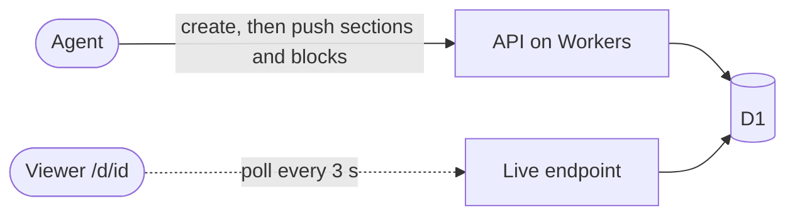

# Reportly

Live reports for coding agents.

Agents that write a full HTML report and upload it at the very end make you wait for everything: twenty UI recordings, a long research pass, a whole review. If the direction was wrong, you find out last. With Reportly the agent creates the document first and sends you the link straight away. Every finding, section, or video then appears as soon as it exists, while you watch the page fill in. Nobody needs to reload.

Documents use one fixed, quiet, dark template: a numbered side nav, cards, tables, Chart.js charts, Mermaid flowcharts, current vs proposed sliders, and video. Agents write only the markup inside each section.

## How it works



- A **document** has a title, a project, a status (`live` or `done`), and an ordered list of **sections**. A section can hold **blocks**, so an agent can add one video at a time without resending the section.
- Each write bumps the document version. Open viewers poll `/api/live/:id?since=<version>`, fetch only the sections that changed, and patch them in place (a video that is playing keeps playing). Polling pauses while the tab is hidden and stops when the document is `done`.
- Media is not stored in Reportly. Agents upload images and videos to R2 or any public host and reference the urls.

## Use it from an agent

1. Sign up on your Reportly server, open **Tokens**, and create a token.
2. Set two environment variables on every machine that runs agents:

   ```sh
   export REPORTLY_URL="https://reportly.vaibhavpathak9984.workers.dev"
   export REPORTLY_TOKEN="rpt_..."
   ```

3. Install the skill by copying or symlinking `skills/reportly` into your agent's skills directory:

   ```sh
   ln -s "$PWD/skills/reportly" ~/.claude/skills/reportly   # or ~/.agents/skills/reportly
   ```

The skill tells the agent when to make a report, how to write each section, and how to push work as it goes. It ships a zero-dependency CLI (Node 18+ or Bun) that reads html from files, so nobody has to escape HTML into JSON by hand:

```sh
R="node skills/reportly/scripts/reportly.mjs"
$R create --title "Checkout flow review" --project medzimi --hero hero.html   # prints id and url
$R section "$ID" flows --after answer --file flows.html
$R block "$ID" flows rec-01 --file rec-01.html
$R done "$ID"
```

Run `$R help` for every command.

## API

Every call needs `Authorization: Bearer <token>`. The main endpoints:

| Method | Path | Does |
|---|---|---|
| `POST` | `/api/v1/docs` | Create a document, optionally with sections |
| `GET` | `/api/v1/docs?q=&project=` | List your documents |
| `GET` / `PATCH` / `DELETE` | `/api/v1/docs/:id` | Read, update title, project or status, delete |
| `PUT` / `DELETE` | `/api/v1/docs/:id/sections/:key` | Create or update, delete a section |
| `PUT` / `DELETE` | `/api/v1/docs/:id/sections/:key/blocks/:blockKey` | Create or replace, delete a block |
| `POST` | `/api/v1/docs/:id/sections/:key/blocks` | Append a block with a generated key |
| `POST` | `/api/v1/docs/:id/ops` | Apply several changes as one version |

The full contract is in [docs/api.md](docs/api.md).

## Security

- Document ids are a title slug plus 14 random characters (about 72 bits), so links cannot be guessed. Anyone with the link can read the document.
- Viewer pages are sent with `X-Robots-Tag: noindex, nofollow` and `Cache-Control: no-store`.
- Documents are served with a `Content-Security-Policy: sandbox` header, so their scripts run in an opaque origin. A script in a document can never act as the logged-in dashboard user.
- API tokens and session tokens are stored only as SHA-256 hashes. A token is shown once, when it is created.
- Passwords are hashed with PBKDF2-SHA-256 and a per-user salt.
- A token only sees its own user's documents. Anything else returns 404.

## Self-host on Cloudflare

Reportly runs on Next.js 16 on Cloudflare Workers (through OpenNext) with a D1 database, so it costs nothing beyond the Workers paid plan.

```sh
bun install
bunx wrangler d1 create reportly   # copy the printed database_id into wrangler.jsonc
bun run db:migrate                 # apply migrations to the remote database
bun run deploy                     # build and deploy the Worker
```

Local development:

```sh
bun run db:migrate:local
bun run dev
```

Other scripts: `lint`, `typecheck`, `cf-typegen` (regenerate Cloudflare binding types), `preview` (run the built Worker locally).

## Project layout

```
app/
  (auth)/            login and register pages
  (app)/             dashboard: documents and tokens
  api/v1/docs/       token API (documents, sections, blocks, ops)
  api/live/[id]/     public live-update endpoint the viewer polls
  d/[id]/            public document viewer
lib/
  document-ops.ts    every write goes through these ops, one version bump each
  template/          the document template: CSS, chart runtime, scripts, live client
  auth.ts, ids.ts    passwords, sessions, tokens, unguessable ids
migrations/          D1 schema
docs/api.md          API contract
skills/reportly/     agent skill, CLI, and example blocks
```
