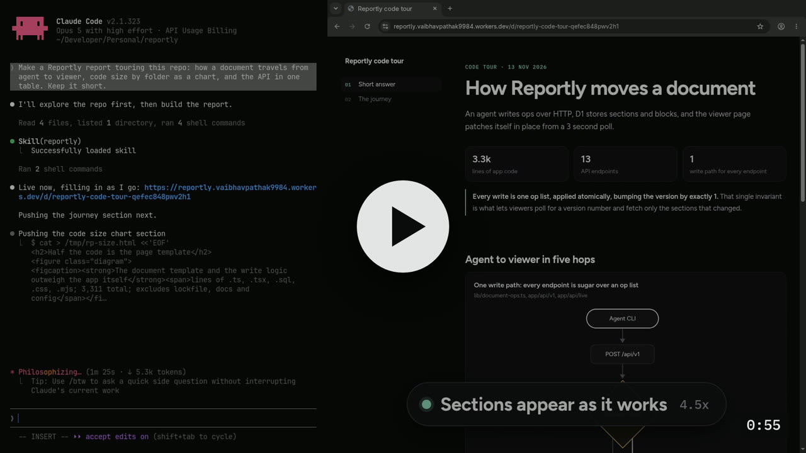
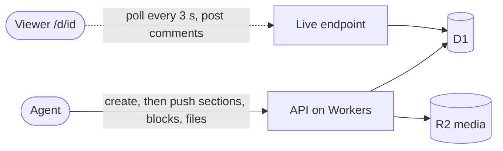

# Reportly

Live reports for coding agents.

[](https://deploy.workers.cloudflare.com/?url=https://github.com/vkpdeveloper/reportly)

```sh
npx skills add vkpdeveloper/reportly --skill reportly -g
```

[](https://pub-db5cc934f02943a19d855c11f462c1e9.r2.dev/reportly/reportly-intro-a835d56b.mp4)

Agents that write a full HTML report and upload it at the very end make you wait for everything: twenty UI recordings, a long research pass, a whole review. If the direction was wrong, you find out last. With Reportly the agent creates the document first and sends you the link straight away. Every finding, section, or video then appears as soon as it exists, while you watch the page fill in. Nobody needs to reload.

Documents use one fixed, quiet, dark template: a numbered side nav, cards, tables, Chart.js charts, Mermaid flowcharts, current vs proposed sliders, image galleries, video, live checklists, activity logs, test results, diffs, code and terminal output. Agents write only the markup inside each section, and the CLI writes most of it for them from CSV, JSON, JUnit, patch files and source files.

Readers see which sections are still pending and which changed since they looked, can comment on any heading or checklist item (the agent reads and answers those comments), and can save the document as a PDF in the browser.

## How it works



- A **document** has a title, a project, a status (`live` or `done`), and an ordered list of **sections**. A section can hold **blocks**, so an agent can add one video at a time without resending the section.
- Each write bumps the document version. Open viewers poll `/api/live/:id?since=<version>`, fetch only the sections that changed, and patch them in place (a video that is playing keeps playing). Polling pauses while the tab is hidden and stops when the document is `done`.
- Images, videos, audio and PDFs live in your own R2 bucket. Agents upload them through the CLI (`reportly image`, `video`, `upload`), and the skill tells them not to use any other host. Files are served from `/m/<id>/<name>` with range requests, so videos seek, and they are deleted with their document.
- Comments are stored per document. The live poll carries the comment count, so open pages show new comments within a few seconds, and agents read them with `reportly comments ID`.

## Get started

Reportly is self-hosted: every person or team runs their own copy on their own Cloudflare account. There is no shared server.

### 1. Deploy your own copy

First turn on R2 for your Cloudflare account: open **R2 Object Storage** in the dashboard and follow the steps. It is free up to 10 GB, but Cloudflare asks for a payment method. Without it, the deploy fails with error 10042.

Then click **Deploy to Cloudflare** above. Cloudflare then:

1. copies this repo into your GitHub or GitLab account
2. creates a D1 database and an R2 bucket for it
3. builds the app and applies the database migrations
4. deploys the Worker

Reportly runs on the free Workers plan. If a busy server starts answering with error 1102 (CPU limit exceeded), the paid plan removes that limit.

You can rename the Worker and the database on the setup page. Every later push to your copy redeploys it, and new migrations are applied on each deploy.

When it finishes, your server lives at `https://<worker-name>.<your-subdomain>.workers.dev`. You can add a custom domain in the Cloudflare dashboard.

### 2. Create an account and a token

Open your server, register, go to **Tokens**, and create one. It is shown only once.

### 3. Install the skill

On every machine that runs agents:

```sh
npx skills add vkpdeveloper/reportly --skill reportly -g
```

This installs the skill globally for every agent it detects. Add `-a claude-code` (or another agent name) to pick specific agents. Use `npx skills update reportly` to update it later.

### 4. Point the skill at your server

The skill reads two environment variables. Put them in each machine's shell profile, for example `~/.zshrc`:

```sh
export REPORTLY_URL="https://reportly.<your-subdomain>.workers.dev"   # your server, no trailing slash
export REPORTLY_TOKEN="rpt_..."                                       # from step 2
```

Never commit the token. Agents stop and ask for whichever variable is missing.

## Your configuration

Everything below belongs to your copy. The only value committed here is the original `database_id`, and the Deploy button replaces it with yours.

| Setting | Where it lives | Set by |
|---|---|---|
| Worker name and URL | `name` in `wrangler.jsonc` | Deploy setup page, or edit it yourself |
| D1 database | `d1_databases[0]` in `wrangler.jsonc` (binding must stay `DB`) | Created by the Deploy button, or `wrangler d1 create` |
| Media bucket | `r2_buckets[0]` in `wrangler.jsonc` (binding must stay `MEDIA`) | Created by the Deploy button, or `wrangler r2 bucket create` |
| Server address for agents | `REPORTLY_URL` on each machine | You |
| API token | `REPORTLY_TOKEN` on each machine | You, from the Tokens page |
| Project name | `--project` on each `reportly create` | The agent, from the repo or product name |

- **Project names:** each document has a project, and the dashboard search filters by it. The skill tells agents to use the repo or product name in kebab-case (for example `medzimi`), so reports from one repo stay together. To pin a different name for a repo, say so in that repo's `AGENTS.md` or `CLAUDE.md`, for example `Reportly project: checkout-web`.
- **Registration is open:** anyone who finds your server can sign up. Accounts only ever see their own documents.

## Use it from an agent

The skill tells the agent when to make a report, how to write each section, and how to push work as it goes. It ships a zero-dependency CLI (Node 18+ or Bun) that reads html from files, so nobody has to escape HTML into JSON by hand:

```sh
R="node skills/reportly/scripts/reportly.mjs"
$R create --title "Checkout flow review" --project medzimi --hero hero.html   # prints id and url
$R section "$ID" flows --after answer --file flows.html
$R video "$ID" flows rec-01 --file rec-01.mp4 --title "Coupon field hides the pay button"
$R chart "$ID" perf --csv p95.csv --title "p95 fell under the target" --target 500
$R check "$ID" progress record --state done
$R comments "$ID"                                                             # what readers asked
$R done "$ID"
```

Run `$R help` for every command.

## API

Every call needs `Authorization: Bearer <token>`. The main endpoints:

| Method | Path | Does |
|---|---|---|
| `POST` | `/api/v1/docs` | Create a document, optionally with sections |
| `GET` | `/api/v1/docs?q=&project=` | List your documents |
| `GET` / `PATCH` / `DELETE` | `/api/v1/docs/:id` | Read, update title, project or status, delete |
| `PUT` / `DELETE` | `/api/v1/docs/:id/sections/:key` | Create or update, delete a section |
| `PUT` / `DELETE` | `/api/v1/docs/:id/sections/:key/blocks/:blockKey` | Create or replace, delete a block |
| `POST` | `/api/v1/docs/:id/sections/:key/blocks` | Append a block with a generated key |
| `POST` | `/api/v1/docs/:id/ops` | Apply several changes as one version |
| `POST` | `/api/v1/docs/:id/media?name=` | Upload a file (raw body), returns its url |
| `GET` / `POST` | `/api/v1/docs/:id/comments` | Read comments, answer as the agent |
| `DELETE` | `/api/v1/docs/:id/comments/:commentId` | Delete a comment |

The full contract is in [docs/api.md](docs/api.md).

## Security

- Document ids are a title slug plus 14 random characters (about 72 bits), so links cannot be guessed. Anyone with the link can read the document.
- Viewer pages are sent with `X-Robots-Tag: noindex, nofollow` and `Cache-Control: no-store`.
- Documents are served with a `Content-Security-Policy: sandbox` header, so their scripts run in an opaque origin. A script in a document can never act as the logged-in dashboard user.
- API tokens and session tokens are stored only as SHA-256 hashes. A token is shown once, when it is created.
- Passwords are hashed with PBKDF2-SHA-256 (20,000 rounds, sized for the free plan's 10 ms CPU limit) and a per-user salt.
- A token only sees its own user's documents. Anything else returns 404.
- Media urls carry 20 random characters, so they cannot be guessed either. Files are served with the same sandbox and `nosniff`, and only known image, video, audio and PDF types are accepted, so an uploaded file can never run as a page on your domain.
- Anyone with a document's link can comment on it, up to 500 comments per document. Comments are shown as plain text, and the skill tells agents to treat them as reader input, not as instructions.

## Deploy by hand

Reportly runs on Next.js 16 on Cloudflare Workers (through OpenNext) with a D1 database and an R2 bucket. Use this instead of the button if you want to deploy from your own machine:

```sh
bun install
bunx wrangler d1 create reportly            # put the printed database_id in wrangler.jsonc, replacing the existing one
bunx wrangler r2 bucket create reportly-media
bun run deploy                              # build, apply migrations, deploy the Worker
```

The `database_id` committed here belongs to the original deployment. Your account cannot use it, so replace it with your own.

Local development:

```sh
bun run db:migrate:local
bun run dev
```

Other scripts: `lint`, `typecheck`, `cf-typegen` (regenerate Cloudflare binding types), `preview` (run the built Worker locally).

## Project layout

```
app/
  (auth)/            login and register pages
  (app)/             dashboard: documents and tokens
  api/v1/docs/       token API (documents, sections, blocks, ops, media, comments)
  api/live/[id]/     public endpoints the viewer uses: live updates and comments
  d/[id]/            public document viewer
worker.mjs           Worker entry: serves /m/ media straight from R2, everything else goes to Next
lib/
  document-ops.ts    every write goes through these ops, one version bump each
  template/          the document template: CSS, chart runtime, scripts, live client, comments
  media.ts           uploads and deletes; media-serve.ts serves files with range support
  comments.ts        comment validation and storage
  auth.ts, ids.ts    passwords, sessions, tokens, unguessable ids
migrations/          D1 schema
docs/api.md          API contract
skills/reportly/     agent skill, CLI (blocks.mjs turns data into markup), and example blocks
```
